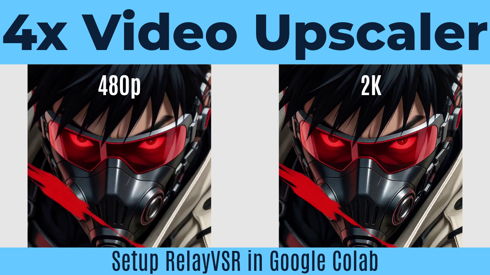

# ⚡ RelayVSR Video Upscaler in Google Colab

This repository contains a simple, automated Google Colab notebook for upscaling videos with **RelayVSR** (x2 and x4). Powered by a ComfyUI backend with `int8_convrot` quantized weights and Flash VAE, it enhances video resolution in just **1 step** while preserving original audio and frame rate—all running for free on a Google Colab T4 GPU.

**🎥 Watch the Tutorial:** [How to Use](https://www.youtube.com/watch?v=soon)

**🚀 Run in Colab:** [Open Google Colab Notebook](https://colab.research.google.com/drive/1uX7r996HPqvdBjE5XncqGA5NUBcONIcZ?usp=sharing)

---

## ✨ Features Supported in this Notebook

This notebook streamlines the entire RelayVSR video super-resolution pipeline into 3 automated cells:

1. **⚙️ Setup Environment**: Automatically installs ComfyUI, `aria2`, `uv`, and `xformers` optimized for Google Colab T4 GPUs.
2. **📥 High-Speed Model Downloader (x2 & x4)**: Rapidly fetches your choice of RelayVSR upscale weights using Aria2c:
   * **x2 Pair:** `relayvsr_x2_lightx2v_int8_convrot` + `relayvsr_flash_vae_x2_fp32`
   * **x4 Pair:** `relayvsr_x4_int8_convrot` + `relayvsr_flash_vae_x4_fp32`
3. **🎬 1-Step Video Upscaling**:
   * **Broad Format Support:** Upload `.mp4`, `.mov`, `.mkv`, `.webm`, `.avi`, or `.m4v` videos directly from your device, or uncheck upload to instantly re-run your last video with new settings.
   * **Built-in Video Slicing (OOM Protection):** Enable `ENABLE_SLICE` and set `START_TIME` and `DURATION` (e.g., `5.0` seconds) to process shorter clips without running out of VRAM on a free T4 GPU.
   * **Audio & FPS Preservation:** Automatically extracts and re-attaches the original audio track and frame rate to your upscaled output.
   * **Custom Output Controls:** Adjust `VSR_DETAIL`, bit depth, color space (`sRGB`, `linear`, `rec709`), chroma subsampling, format (`mp4`, `webm`), and codec (`h264`, `vp9`, `av1`), with **Auto-Download** enabled by default.

## 🛠️ How to Use

1. Click the **Open in Colab** badge above.
2. Go to **Runtime > Change runtime type** in the top menu and make sure **T4 GPU** is selected.
3. Run **Cell 1 (Setup Environment)** to install ComfyUI and all required packages.
4. Go to **Cell 2 (Download Models)**, select either the **x2** or **x4** model pair from the `SCALE_PAIR` dropdown, and click Play.
5. Go to **Cell 3 (Upscale Video)**:
   * Keep `UPLOAD_NEW_VIDEO` checked to upload your video file when prompted (uncheck it to reuse your previously uploaded video).
   * Leave the default RelayVSR settings (`STEPS = 1`, `CFG = 1.0`, `euler`, `simple`) for best results.
   * *(Optional)* If your video is long and causes an Out of Memory (OOM) error on T4, check `ENABLE_SLICE` and set `DURATION` to `5.0`.
   * Click Play, upload your video, and wait for the upscaled video to display and automatically download to your device!

## 🤝 Credits

* **Notebook Creator:** [@CoinNoin](https://www.youtube.com/@CoinNoin)
* **Base Models:** [Comfy-Org / RelayVSR](https://huggingface.co/Comfy-Org/RelayVSR)
